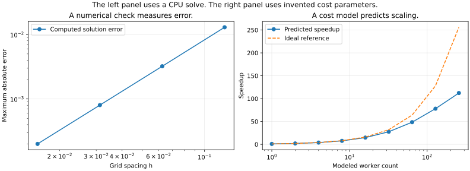

# Numerical and Parallel Computing

Prepared for Arun Sharma. Codex drafted this edition, and Claude refinement is pending.

**This course explains numerical algorithms and parallel computing through worked examples and runnable experiments.**

The study path brings together CSCI 5302 and CSCI 5451. The lessons use original explanations and code, with source links to the public course materials and four associated textbook outlines. You can read the {doc}`getting-started/index` page first or choose a lesson below.

You can also open the [complete interactive study reader](_static/STUDY_GUIDE.html). It combines every lesson into one file that you can save for offline study.

The {doc}`reference/coverage` ledger records coverage and depth. The {doc}`reference/validation` page separates verified CPU experiments from hardware-dependent examples. The {doc}`reference/claude-handoff` page gives the next editor a concrete continuation plan.



The left panel checks a manufactured diffusion problem. The right panel uses invented communication costs. Lesson 47 explains both experiments.

## You can study the topics in three connected tracks.

| Lesson | Topic |
|---|---|
| 00 | {doc}`0. Getting ready <lectures/00-getting-ready>` |
| 01 | {doc}`1. Errors and floating-point arithmetic <lectures/01-errors-floating-point>` |
| 02 | {doc}`2. Linear systems and direct solvers <lectures/02-linear-systems>` |
| 03 | {doc}`3. Least squares, orthogonality, and singular values <lectures/03-least-squares-svd>` |
| 04 | {doc}`4. Eigenvalues, invariant subspaces, and matrix transformations <lectures/04-eigenvalues>` |
| 05 | {doc}`5. Nonlinear equations and safeguarded iteration <lectures/05-nonlinear-equations>` |
| 06 | {doc}`6. Unconstrained optimization and nonlinear least squares <lectures/06-unconstrained-optimization>` |
| 07 | {doc}`7. Constraints, quadratic programs, and support vector machines <lectures/07-constrained-optimization-svm>` |
| 08 | {doc}`8. Interpolation, splines, and approximation choices <lectures/08-interpolation-splines>` |
| 09 | {doc}`9. Numerical integration and differentiation <lectures/09-quadrature-differentiation>` |
| 10 | {doc}`10. Initial-value problems for ordinary differential equations <lectures/10-ode-initial-value>` |
| 11 | {doc}`11. Boundary-value problems and spatial discretization <lectures/11-boundary-value>` |
| 12 | {doc}`12. Partial differential equations and sparse spatial operators <lectures/12-pde>` |
| 13 | {doc}`13. Fourier transforms, fast algorithms, and convolution <lectures/13-fourier-fft>` |
| 14 | {doc}`14. Random numbers, simulation, and uncertainty <lectures/14-random-simulation>` |
| 15 | {doc}`15. Iterative linear solvers and preconditioning <lectures/15-iterative-solvers>` |
| 16 | {doc}`16. Numerical workflows, multivariate models, and cross-language practice <lectures/16-numerical-workflow>` |
| 17 | {doc}`17. Parallel architectures and memory locality <lectures/17-architecture-cache>` |
| 18 | {doc}`18. Decomposition, dependency graphs, and load balance <lectures/18-decomposition-task-graphs>` |
| 19 | {doc}`19. Threads, synchronization, and OpenMP <lectures/19-pthreads-openmp>` |
| 20 | {doc}`20. Interconnection networks and communication costs <lectures/20-communication-networks>` |
| 21 | {doc}`21. MPI point-to-point communication and correctness <lectures/21-mpi-point-to-point>` |
| 22 | {doc}`22. MPI collectives, groups, and virtual topologies <lectures/22-mpi-collectives-topology>` |
| 23 | {doc}`23. Speedup, efficiency, scaling, and isoefficiency <lectures/23-performance-models>` |
| 24 | {doc}`24. Dense matrix algorithms and two-dimensional layouts <lectures/24-dense-matrix-cannon>` |
| 25 | {doc}`25. Parallel sorting, merging, and selection <lectures/25-sorting-merging>` |
| 26 | {doc}`26. Graph algorithms, sparse matrices, and partitioning <lectures/26-graphs-sparse-partitioning>` |
| 27 | {doc}`27. Parallel search and dynamic programming <lectures/27-search-dynamic-programming>` |
| 28 | {doc}`28. Parallel Fourier transforms and data redistribution <lectures/28-parallel-fft>` |
| 29 | {doc}`29. Hybrid programming and an introduction to quantum computation <lectures/29-hybrid-quantum>` |
| 30 | {doc}`30. From course exercises to a reproducible parallel project <lectures/30-course-project-workflow>` |
| 31 | {doc}`31. CUDA execution, threads, and multidimensional data <lectures/31-cuda-execution>` |
| 32 | {doc}`32. Warps, scheduling, divergence, and occupancy <lectures/32-scheduling-occupancy>` |
| 33 | {doc}`33. Memory spaces, data reuse, and tiled matrix multiplication <lectures/33-memory-tiling>` |
| 34 | {doc}`34. Coalescing, roofline models, and optimization experiments <lectures/34-gpu-performance>` |
| 35 | {doc}`35. Convolution, constant memory, and halo tiles <lectures/35-convolution>` |
| 36 | {doc}`36. Stencil computations and space-time dependencies <lectures/36-stencils>` |
| 37 | {doc}`37. Histograms, atomic updates, and privatization <lectures/37-histograms-atomics>` |
| 38 | {doc}`38. Parallel reductions and numerical order <lectures/38-reductions>` |
| 39 | {doc}`39. Prefix sums and work-efficient coordination <lectures/39-prefix-scan>` |
| 40 | {doc}`40. Parallel merge, co-ranking, and sorting patterns <lectures/40-merge-sort>` |
| 41 | {doc}`41. Sparse matrices and graph traversal on GPUs <lectures/41-sparse-graphs>` |
| 42 | {doc}`42. Convolutional networks, GEMM, and library choices <lectures/42-deep-learning>` |
| 43 | {doc}`43. MRI reconstruction and electrostatic potential maps <lectures/43-mri-electrostatics>` |
| 44 | {doc}`44. CUDA streams, communication overlap, and GPU clusters <lectures/44-streams-clusters>` |
| 45 | {doc}`45. Dynamic parallelism, libraries, and accelerator evolution <lectures/45-dynamic-parallelism-future>` |
| 46 | {doc}`46. GPU numerical reliability and a complete project workflow <lectures/46-gpu-numerics-project>` |
| 47 | {doc}`47. A numerical and parallel computing capstone <lectures/47-integrated-capstone>` |

```{toctree}
:hidden:
:maxdepth: 2
:caption: Getting Started

getting-started/index
getting-started/run-locally
getting-started/run-in-browser
```

```{toctree}
:hidden:
:maxdepth: 2
:caption: Numerical methods

lectures/00-getting-ready
lectures/01-errors-floating-point
lectures/02-linear-systems
lectures/03-least-squares-svd
lectures/04-eigenvalues
lectures/05-nonlinear-equations
lectures/06-unconstrained-optimization
lectures/07-constrained-optimization-svm
lectures/08-interpolation-splines
lectures/09-quadrature-differentiation
lectures/10-ode-initial-value
lectures/11-boundary-value
lectures/12-pde
lectures/13-fourier-fft
lectures/14-random-simulation
lectures/15-iterative-solvers
lectures/16-numerical-workflow
```

```{toctree}
:hidden:
:maxdepth: 2
:caption: CPU and distributed computing

lectures/17-architecture-cache
lectures/18-decomposition-task-graphs
lectures/19-pthreads-openmp
lectures/20-communication-networks
lectures/21-mpi-point-to-point
lectures/22-mpi-collectives-topology
lectures/23-performance-models
lectures/24-dense-matrix-cannon
lectures/25-sorting-merging
lectures/26-graphs-sparse-partitioning
lectures/27-search-dynamic-programming
lectures/28-parallel-fft
lectures/29-hybrid-quantum
lectures/30-course-project-workflow
```

```{toctree}
:hidden:
:maxdepth: 2
:caption: GPU computing

lectures/31-cuda-execution
lectures/32-scheduling-occupancy
lectures/33-memory-tiling
lectures/34-gpu-performance
lectures/35-convolution
lectures/36-stencils
lectures/37-histograms-atomics
lectures/38-reductions
lectures/39-prefix-scan
lectures/40-merge-sort
lectures/41-sparse-graphs
lectures/42-deep-learning
lectures/43-mri-electrostatics
lectures/44-streams-clusters
lectures/45-dynamic-parallelism-future
lectures/46-gpu-numerics-project
```

```{toctree}
:hidden:
:maxdepth: 2
:caption: Integration

lectures/47-integrated-capstone
```

```{toctree}
:hidden:
:maxdepth: 2
:caption: Reference

reference/api
reference/claude-handoff
reference/coverage
reference/glossary
reference/how-it-works
reference/sources
reference/validation
```
